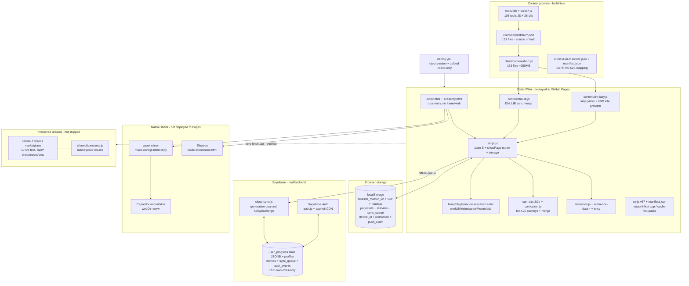

# Deutsch Master — Platform Readiness Audit

**Date:** 2026-10-15 (UTC)
**Repo:** `C:\Users\mosab\Desktop\deutsch-master2`
**Branch:** `main`
**HEAD at audit time:** `3d26062` — `fix: Phase 1 sentence remediation (R1-R9 de/ar fixes, re-emitted sent packs + manifest/lazy, www mirror sync, tests + review queues; content remains UNREVIEWED, no linguistic approval)`
**Expected `origin/main`:** `7dbd6fc` (verified — local `main` is 2 commits ahead: `8dda233`, `3d26062`)
**Method:** read-only static audit. No `git reset/clean/stash`, no staging, no commits/pushes/deploys, no migrations applied, no content regeneration, no Supabase/RLS/auth changes, no `www/` mirror edits. Live-device, live-network, and live-Supabase behaviors are marked **UNVERIFIED** where they were not executed. Static code review is distinguished from verified runtime behavior throughout. Secret values are never printed.
**Single deliverable:** this file only (`docs/academy/PLATFORM_READINESS_AUDIT.md`). No application source, content pack, schema, config, or unrelated doc was modified.

---

## 1. Executive summary

Deutsch Master at `3d26062` is a **mature single-learner offline-first static PWA** with a large generated content library and a disciplined test harness — but it is **not a multi-academy platform** and **no level is linguistically certified**.

What is real and solid:

- Complete learner loop for self-study (A1–B1 pools + B2 thin overlays): vocab/sentences/flashcards/grammar/verbs/reference/exercises/test-center/placement/listening/progress/mistakes/search/language-switch/offline + cloud sync plumbing — all wired to real local data and covered by an explicit P0/P1 regression suite (`tests/regression-suite.md`, `tests/traceability-matrix.md`, `tests/test-cases.json`).
- Honest content pipeline: `tools/clib` → `client/content/src/*.json` (source of truth) → `client/content/dm-*.js` runtime packs → `client/content/dm-lib.js` (sync merge) + `client/content/dm-lazy.js` (lazy) → `www/` mirror via `tools/make-www.js`; versioned deploys via `tools/inject-version.js` + `.github/workflows/deploy.yml` (uploads `./client` only to GitHub Pages). Actual backend is Supabase (`supabase/migration.sql`: `profiles/user_progress/sync_queue/devices/auth_events`, own-row RLS), not `server/`.
- Honest quality posture at HEAD: `client/content/review-status.json` declares `unreviewed: 150000, approved: 0` — "automated fixes are not linguistic approval." The `errors=0 / warnings=1913` gate result is structural only and must never be cited as language correctness.

What is missing or blocking academy handover:

1. **Zero multi-academy implementation.** `client/academy.html` (933 lines) is a learner-shell copy of `client/index.html` with no auth section and no teacher/class/certificate/payment/subscription/branding logic. Live Supabase has no `role/academies/classes/members/certificates/subscriptions/payments`. The only academy schema is `audit/proposed-teacher-schema.sql`, header-marked `DRAFT ONLY — DO NOT APPLY`.
2. **Content is unreviewed and B2/exams are misrepresentable.** Library recount: vocab 104,640 (B2 only 1,692), sentences 150,000 (B2 0; KX 60.6%), grammar 3,069 (B2 0), exercises 697,330 (B2 0), dialogues/reading/listening 10,000/5,000/10,000 (all B2 0), exams 10,000 rows that are **config shells with zero question items** (`hasQ=false` verified on `client/content/src/exam-01.json`), loaded into `window.DM_EXAMS` but consumed by **zero** call sites outside `dm-lazy.js`. Real exams are runtime-assembled by `client/assess.js` from vocab/sentence/grammar pools — a legitimate design, but "10,000 exams" must never be advertised.
3. **A1 is the only chapter-mapped level; A2/B1 are level pools; B2 is CURR-only thin overlays** (~40 words + ~16 sentences per K15–K25 chapter). Hand-sample evidence (single-rater, `audit/sentences-sample100-labeled.csv`): OK 21 / Awkward 29 / Wrong 50. Full-bank defect classes (fabricated compounds, template monoculture, level leaks) persist after R1–R9 mechanical fixes.
4. **Operational gaps:** no CI test job (deploy-only workflow), no `npm test` script, manual `npm run www` mirror discipline, documented merge limitation (deletions don't propagate — `client/cloud-sync.js:471-473`), PWA install-half + real-device/APK/iOS/Electron all unverified, no privacy/terms pages, delete-account is a placeholder toast.

**Bottom line for an academy:** pilotable as a **supervised single-cohort self-study companion for A1 (with teacher review of assigned slices)** only after the acceptance gates in §10 are met. It cannot be handed over as a multi-academy SaaS, cannot be sold as "complete A1–B2" or "10,000 exams," and no content may be presented as teacher-approved.

---

## 2. Architecture diagram and data-flow explanation

### 2.1 Mermaid diagram

### 2.2 Data-flow explanation

- **Build time:** `tools/build-*.js` read `tools/clib/*.js` and emit `client/content/src/*.json` + `client/content/dm-*.js` (`tools/build-content-library.js:1-7`). `tools/gen-curriculum-manifest.js` emits `client/content/curriculum-manifest.json` (CEFR K0–K25, Netzwerk-neu A1–B1 + Aspekte B2 alignment note). Only 7 packs boot synchronously (`client/index.html:1008-1014`: `dm-vocab-01/02`, `dm-sent-01/02/03`, `dm-gram-01`, `dm-dlg-01`); the rest load lazily via `client/content/dm-lazy.js:120 loadPack` / `:173 loadKindProgress` with an 8 MB idle-prefetch budget that skips `ex` (176 MB / 84 packs), respects `saveData/2G`, and defers when hidden (`dm-lazy.js:286-296`). Merges mutate globals (`VOCAB/SENTENCES/GRAMMAR/SENT_FILL/DM_DIALOGS/DM_READING/DM_LISTENING/DM_EXAMS`, `dm-lazy.js:20-97`).
- **Runtime:** no framework, no bundler, zero npm runtime deps (`package.json:16-22`). `client/script.js:2064-2085 showPage` toggles `.page` divs; 15+ modules wrap `showPage` (`adv.js:950-952`, `dlife.js:209-211`, `labsx.js:1045-1047`, `life.js:464-466`, `learn.js:564-567`, `play.js:1223-1226`, `smart.js:914-916`, etc.) — order-dependent fragile chain. Durable store is `localStorage deutsch_master_v2` + per-uid keys + `:backup:pre-identity` (`script.js:1410,1440-1531 DMIdentity`), `dm_sync_queue` (`cloud-sync.js:774-796`), `deutsch_master_pagestate_v1` + `dm_lastview_v1` (`page-state.js:39,54,432,473,502`).
- **Cloud:** `client/supabase-config.js:14-17` holds only the browser-safe publishable key (public by design per header `:1-13`); `client/app-init.js:68-80` injects `@supabase/supabase-js@2` from CDN and disables auth gracefully if missing. `client/auth.js:32-68` (`persistSession/autoRefresh/PKCE`), `client/cloud-sync.js:234 fullSync / :352 uploadChanges / :426 downloadState / :526 mergeStates` sync a single `user_progress.state JSONB` (`supabase/migration.sql:24-32`) with generation guards (`cloud-sync.js:28-40`) and `MAX_QUEUE=100` (`:806,842-848`). RLS is own-row-only (`migration.sql:93-158`).
- **PWA:** `client/manifest.json:1-20` (`start_url ./index.html`, `display:standalone`, RTL), `client/sw.js:2 DM_CACHE=german-academy-v57` — network-first for HTML/JS/CSS (`:85-104`), cache-first for immutable versioned packs (`/content/dm- + ?v=`, `:51-58`), images cache-first, cross-origin (Supabase/CDN) never intercepted (`:61-67`), `?v=`-stripped fallback (`:116-125`). Updates via `launch.js:6-28` hourly `update()`; versioning via `tools/inject-version.js:1-40` (`?v=<7charSHA>`, idempotent).
- **Deploy/rollback:** `.github/workflows/deploy.yml:30-39` runs `inject-version ${sha}` then uploads `./client` only. `www/`, `server/`, `shared/` are never deployed. `tools/make-www.js:1-23` is a blind recursive `client/ → www/` copy (Capacitor `webDir=www`, `capacitor.config.json:4`; Electron loads `client/index.html` directly, `electron/main.js:16`). Rollback = redeploy a prior SHA (re-runs version stamping); no DB migration rollback path exists because no academy migration has been applied.
- **Duplication / coupling / SPOF (verified):** `client/dm-search.js` + committed stale `client/dm-search.js.pre-fix-bak`; `academy.html ≈ index.html` (145 diff objects — two entries to version/cache/cap); triplicated search stacks (`DM_LIB.search` / `DM_LIB_MORE.searchAll` / `DMSearch`); overlapping training stacks (`assess.js` vs `testcenter.js` vs `smart.js` vs `sentex.js` vs `glab.js`/`labsx.js`); load-order-sensitive global bank mutation; single durable `localStorage` + CDN hard dep for auth/sync; `?v=` + `DM_CACHE-v57` staleness if `npm run www` / `inject-version` is skipped. `server/` (marketplace Express `/api/auth,catalog,shop,orders,engage,cms,admin`, `server/src/app.js:28-35`) has zero `fetch("/api/` consumers in `client/` and is explicitly preserved-not-shipped (`README.md:95-99`) — keep separated.

---

## 3. Feature-by-feature readiness matrix

Statuses: `verified` = traced in code to real data + test mapping; `partial` = real but scoped/fallback/thin or live-verification missing; `broken` = evidenced defect blocking the journey; `missing` = no implementation; `unverified` = could not be verified read-only. Static existence alone never earns `verified`.

| # | Feature | Status | Entry points | Actual data source | Test coverage | Defects / limits |
|---|---|---|---|---|---|---|
| 3.1 | Home / dashboard | `verified` | `client/index.html:152 page-dashboard`, `client/home.js:45 cmdStats`, `:117 cmdHero`, `:209 cmdNext`, `client/study.js:305 renderStudyDash`, `client/script.js:2565-2612` | Local `VOCAB+SENTENCES+GRAMMAR+S` + `DMProgress` (`script.js:1536,1411`) | `NAV-001/002 PROG-007/009` via `tools/e2e.js`, `runtime-qa.js` (reported PASS) | Dual dashboards (`home.js` + `study.js`) overlap — maintenance risk, not broken |
| 3.2 | Vocabulary | `verified` | `client/index.html:380`, `client/script.js:2458 renderVocab`, `:1159 buildVocab` | `client/content/dm-vocab-01..22.js` + `curr-a1x.js` + `curriculum.js:225` | `VOC-001..008` via `audit-curriculum/smoke-curriculum/runtime-qa` (reported PASS) | Cold start shows A1/A2 until lazy merge; B2 thin (1,692). Headword pollution — see §4 |
| 3.3 | Sentences | `verified` | `client/index.html:450,459`, `client/script.js:3121 renderSentences`, `client/sentex.js:1`, `sentx-a2/b1/b2.js` | `client/content/dm-sent-01..31.js` + `sent-a1.js` + `curriculum.js:248-249` | `SENT-001..005` (reported PASS) | 60.6% KX; template monoculture; fabrications persist — see §4 |
| 3.4 | Flashcards (lightweight SRS) | `verified` | `client/index.html:398`, `client/script.js:2945 renderFlash`, `client/progress.js:165 nextReview`, `:187 buildQueue` | Derived from `VOCAB` + `S.status/review` (`script.js:1596-1597`) | `CARD-001..006`, `tools/test-flashdir.js (96/96)` (reported PASS) | Two SRSs coexist (here + Anki clone) — confusing but intentional |
| 3.5 | Grammar | `verified` | `client/index.html:472`, `client/script.js:3254 renderGrammar`, `client/glab.js:710`, `client/study.js:918` | `dm-gram-01/02.js` + curr merges (`curriculum.js:228-235`) | `GRAM-001..005` (reported PASS) | None static; B2 grammar library = 0, CURR-only |
| 3.6 | Verbs | `verified` | `client/index.html:465`, `client/script.js:3188 renderVerbs`, `:1367 conjugateVerb` | Generated from `VOCAB type=verb` + rules, no separate pack | `VERB-001..004` (reported PASS) | Irregular quality follows vocab data |
| 3.7 | Reference (encyclopedia) | `verified` | `client/index.html:478`, `client/reference.js:287 renderReference`, `:387 search`, `:452 topic` | `reference-data-*.js` (15 files) + `reference-ency.js` (91 KB) | `REF-001..005`, `tools/check-reference.js`, 124 topics 0 missing (reported PASS) | None static |
| 3.8 | AnkiDroid integration | `partial` | `client/index.html:436`, `client/ankidroid.js:14 IIFE`, `:153 gradeCard`, `:258 createDeck` | `S.anki` in `user_progress.state` (`ankidroid.js:94-98`), merged (`cloud-sync.js:474`) | No `tests/test-cases.json` ANKI IDs — coverage gap | **Not real AnkiDroid**: no Intent/ContentProvider/`.apkg` (`study.js:25` says `.apkg wird nicht unterstützt`); in-app SRS clone + CSV/JSON export only |
| 3.9 | Exercises (dm-ex + sentex + smart + glab) | `verified` | `client/sentex.js:1`, `client/smart.js:512 smBuildSession`, `:626 smStart`, `client/index.html:607,625` | `dm-ex-01..88.js` + `SENT_FILL` + `GLAB_BANK` + CURR fills | `TRAIN-001..008` 35/35 via `test-smart.js` (1 known flaky tail, rerun PASS) | Flaky tail documented, not fixed |
| 3.10 | Test Center (quiz hub) | `verified` | `client/index.html:810 page-quiz`, `client/testcenter.js:48 DMTestCenter`, `:440 renderSection` | Same pools, sliced to valid content (`assess.js:110-135 stratify`) | `TEST-003..008`, `test-quiz-shuffle.js`, `e2e.js` (reported PASS) | Honesty guard (`as_c_no_thin`) correctly blocks thin B2 — B2 users hit this often |
| 3.11 | Placement tests | `partial` | `client/learn.js:107 buildPlacement`, `:118 startPlacement`, `client/assess.js:97` | Stratified sample of vocab/grammar/sent + lis/read/dlg packs | `TEST-001/002` logic PASS, render BLOCKED (needs mic/audio) | Speaking optional → typing fallback, confidence low; adaptive branching **UNVERIFIED** live |
| 3.12 | Final exams | `partial` | `client/learn.js:157 startFinal`, `client/assess.js:17-35` (`PASS=70`, `EXAM_TIME_SEC=1200`), `dm-exam-01/02.js` | dm-exam shells (unused) + level word/grammar counts; questions runtime-assembled | No dedicated `EXAM-*` IDs; indirect via `TEST-004/006` | B2 final often gated/locked (`tc_prep/as_c_exam_soon`); resume flow **UNVERIFIED** |
| 3.13 | Listening | `verified` (static; device audio UNVERIFIED) | `client/index.html:499,661,631,643`, `client/learn.js:200 renderListen`, `client/script.js:1912 speakGerman` | `dm-lis-01/02.js` + device TTS (no MP3 packs) + `tatoebaAudioPolicy` (`dm-search.js:599`) | `LISTEN-001..004`, `test-adv/test-labsx/e2e (69+41)` (reported PASS) | No offline audio files; TTS quality per-device **UNVERIFIED** |
| 3.14 | Speaking | `partial` | `client/index.html:505`, `client/learn.js:252 renderSpeak`, `:258 hasSR`, `:294 micSecureOk`, `:318 startMic`, `client/assess.js:2224 startAsrMic` | Prompts from sentences/dialogues; no server STT | `SPEAK-001..004` runtime PASS but needs mic/browser | Honest fallback to typing (`as_q_no_sr/no_mic/no_hear`); HTTPS required; accuracy **UNVERIFIED** |
| 3.15 | Dialogues / chat / situations | `partial` | `client/index.html:511,517,523,649`, `client/smart.js:305-331`, `client/life.js:104-203` | Only 3 dlg packs (`dm-dlg-01..03`) + CURR level-only | Under `TRAIN/DATA-002` link integrity; no dedicated IDs | Small library; scripted MCQ, not generative chat — label overstates |
| 3.16 | Reading / stories | `partial` | `client/index.html:583`, `client/world.js:137 renderStories`, `client/study.js:674` | Single `dm-read-01.js` + `CURR_READING` level-only (`curriculum.js:209`) | `DATA-001/005` validity only; no READING IDs | Thin B1/B2; drills not graded readers (see §4) |
| 3.17 | Progress / stats / analytics | `verified` | `client/index.html:872,804`, `client/progress.js:21 DMProgress`, `:82 logAttempt`, `:275 weeklySummary`, `client/script.js:1974,1994` | `localStorage` + `S.events` → `user_progress.state` | `PROG-001..010` 32/32 via `test-progress/test-upgrade` (reported PASS) | `PROG-008` real-restart BLOCKED note; logic sound |
| 3.18 | Error review (mistakes notebook) | `verified` | `client/index.html:858`, `client/script.js:3466 recordMistake`, `:3858 renderMistakes`, `client/progress.js:221 classifyError` | `S.mistakes {done,count,history,skill}` local + synced JSONB | `MIST-001..007` (reported PASS) | None static |
| 3.19 | Learning plans (planner) | `partial` | `client/index.html:883`, `client/script.js:4046 renderPlanner` (defaults 20 words/10 sents/30 min, `:1411`) | `S.planner` local + synced | No `PLAN-*` IDs; indirect via PROG | Counters only; minutes `+5` heuristic; no adaptive replanning |
| 3.20 | Reminders (push) | `verified` (static; delivery UNVERIFIED) | `client/push.js:20 defaults`, `:139 pushDecide`, `:163 pushTick`, `:249 pushNative`, `client/sw.js:59-121` | `S.push` + due/planner state | `PWA-008` 105/105 via `test-push.js` (reported PASS) | `PWA-009` install-half BLOCKED (real device) |
| 3.21 | Search (DMSearch) | `verified` (online; partial offline) | `client/index.html:129-130`, `client/dm-search.js:922 searchAll`, `:322 localSearch`, `:1996 DMSearch` | Local banks + live Wiktionary/Tatoeba/Commons (`dm-search.js:421,525,626,742`) | `VOC-002/003/007 VERB-002 PERF-001` 25/25 via `test-search` (reported PASS) | External fetch needs network; offline degrades to local only |
| 3.22 | Language switching (ar/en/de UI) | `verified` | `client/index.html:108-110,925-926 data-setlang`, `client/study.js:52 uilang`, `:122-178 refreshLangViews` | `I18N.ar/en/de` dicts + per-word `ar/en` fields | `DATA-004 AI-005` via `test-languages/check-translations` (reported PASS) | Some hardcoded Arabic fallbacks; not broken |
| 3.23 | Responsive nav | `verified` (static; gestures UNVERIFIED) | `client/index.html:48,125,150`, `client/script.js:2094-2144 DMDrawer`, `index.html:952-956 dm-bnav` | None | `NAV-003/004 UI-001..004` via `runtime-qa` (reported PASS) | 360×800 gesture not re-tested here |
| 3.24 | Accessibility | `partial` | `client/index.html:186,210,307 progressbar`, `:703-704 tablist`, `script.js:2109-2118` drawer aria | None | `A11Y-001..004` runtime PASS, "needs audit env" | No skip-link; no focus-trap evidenced; needs manual axe/keyboard audit |
| 3.25 | Guest mode | `partial` (live UNVERIFIED) | `client/app-init.js:945 null=guest`, `:994-1046 isolation`, `:158 guests hide logout` | Guest `localStorage` key; cloud untouched until auth | `tools/test-auth-identity.js (+--cdp)` claimed PASS, not re-run here | Snapshot discipline sound on read; leakage live-test missing |
| 3.26 | Registration / login / logout / recovery | `partial` (static verified, live UNVERIFIED) | `client/index.html:685-789 page-auth`, `client/app-init.js:471 initAuthUI`, `client/auth.js:126 Google`, `:155 Facebook`, `:175 email`, `:192 signup`, `:280,309 OTP`, `:358 reset`, `:387 signOut` | Supabase `auth.users` + `profiles` (`migration.sql:11-19`) + `auth_events` | `test-auth-identity/test-auth-dom` per P0 | Facebook/SMS fail closed with Arabic errors unless dashboard enables them — correct but buttons error; live round-trip not executed |
| 3.27 | Offline + cloud sync | `partial` | `client/sw.js:2,32,35,59-121`, `client/cloud-sync.js:234 fullSync`, `:352 upload`, `:426 download`, `:526 mergeStates` | `localStorage` ↔ `user_progress {state,version,device_id}` + `sync_queue` + `devices` (`migration.sql:24-65`) | `PWA-001..009` via `test-sw-update (20/20)` except `PWA-009` BLOCKED | **Documented:** deletions don't propagate through merge (`cloud-sync.js:471-473`); `www/` sync manual; `?v`-mismatch falls back to older cache |
| 3.28 | Career / life-sim / extras | `partial` | `curr-b2*.js`, `client/career.js:331`, `client/life.js:223`, `simulator/dlife/mygermany/howto.js` | `curriculum-manifest.json` (Netzwerk-neu A1–B1 + Aspekte-B2), `CAREER_TRACKS` 30/30 | `NAV-005 DATA-002/003 GUIDE-001..008` 68/68 (reported PASS) | B2 K12–K25 thin → frequent `tc_nokap/tc_prep` states; scope-limited, not broken |

---

## 4. A1–B2 content and curriculum coverage matrix

> Source of truth recount on HEAD (`client/content/src/*.json` + `client/content/dm-lazy.js:15-18` + manifests). `audit/*.csv`, `banks-summary.json`, `sentences-summary.json`, `AUDIT_REPORT.md` are **untracked leads only** — every structural claim below was re-verified against committed data. Linguistic quality: **0 approved / 150,000 unreviewed** (`client/content/review-status.json:7`; contract `audit/review-status.schema.json` — scripts/gates can never set `approved`; sidecar not consumed at runtime by design).

### 4.1 Library totals (recounted)

| Bank | Total | A1 | A2 | B1 | B2 | Chapter mapping |
|---|---|---|---|---|---|---|
| vocab | 104,640 | 51,975 | 34,658 | 16,315 | **1,692** | word-level `kap` NONE in cache; synthetic `kapForLevel` (`dm-lazy.js:15-18`: A1 hash→K1–K5, else KX) |
| sentences | 150,000 | 59,156 | 60,537 | 30,307 | **0** | K1 11,787 / K2 11,806 / K3 11,837 / K4 11,857 / K5 11,869 / **KX 90,844 (60.6%)** |
| grammar | 3,069 | 1,039 | 1,387 | 643 | **0** | K1 257 / K2 211 / K3 202 / K4 168 / K5 201 / KX 2,030 |
| exercises | 697,330 | 251,855 | 300,658 | 144,817 | 0 (gate folds B2→B1) | KX-heavy; CURR fills on-merge |
| dialogues | 10,000 | 3,598 | 4,775 | 1,627 | 0 | level-only, no chapter |
| reading | 5,000 | 2,000 | 2,000 | 1,000 | 0 | level-only |
| listening | 10,000 | 4,117 | 4,477 | 1,406 | 0 | level-only |
| exams | 10,000 | 3,334 | 3,333 | 3,333 | 0 | **shells only — §4.3** |

CURR overlays (only B2 content): K0–K25 (`curr-*.js` + `curriculum-manifest.json`). `currWords`: K1 39, K2 256, K3 290, K4 141, K5 317, K6 105, K7 101, K8 96, K9 141, K10 93, K11 74, K12 78, K13 60, K14 92, **K15–K25 40 each**. `currSent`: 1–25/chapter (K9 25 max; B2 K15–K25 16 each). `currGram`: 1–8/chapter. Manifest `gaps[]` explicitly: *"B2 library bank: sentences=0, grammar=0, exercises=0, dialogues=0, reading=0, listening=0, exams=0; B2 vocab=1692 (thin). Covered at app layer by CURR overlays."*

### 4.2 Per-level assessment

**A1 — largest pool, fully chapter-mapped, but polluted source.** Usable core exists (`lv00001 Frau/die/Frauen/المرأة`) but: 4,362 adjective-phrase headwords (`die rücksichtsvolle Chirurgietragbahre`, `die offensichtliche Picknickrote` — `vocab-07.json` + `banks-summary.json`), 79 exact-dup headwords, basics missing (Tourist/Enkelin/Dame/Bäckerei 0 exact per audit). Sentences 59,156 K1–K5-mapped; hand-sample n=100: OK 21 / Awkward 29 / Wrong 50 (`audit/sentences-sample100-labeled.csv`); fabrications in A1 chapters (`ls26210 Lkwstraßenbahnen A1/K3`, `ls26357 Schmerzstent A1/K1` — re-probed on HEAD, still present). A1-vs-B1/B2 leak 20,291 (34.3%) mixes true leaks (`die Pfändung`) with misleveled basics (`Mensa/Hausaufgaben=B1`). Arabic: R3–R9 fixed mechanical classes (lowercase 5,953→0, modal-tail 1,088→0, slash 4,619→183 residual queued, `أن`-mood ~2,208→0 — slash residual re-verified; deeper agreement `النساء يكتبون`/komparativ documented as teacher-future, `audit/REMEDIATION_REPORT.md`). Grammar pedagogy real (sample `lg0101`: DE+AR title, body with ما هو؟/لماذا/كيف/خطأ شائع/تلميح, 2× `[de,ar]` examples, `mistakes[{w,r,why}]`, `related[]`, `quiz{...}`; gate enforces `body≥80` chars, `examples≥2`). Exercises 12 types (gap 413,224 dominant; choice 140,063; order 52,640; truefalse 35,000; translate 12,833; article 11,921; plural 10,400; conjugate 6,018; dialogue 7,844; listen 4,684; classify 2,531; correct 172) — structurally valid (0 bad indices; 621 dup-options full-bank). Reading exists (2,000) but drills not readers (`lr00001` = 6× `anrufen` slot-fill; questions cite random bank sentences — weak construct validity; avg 6.1 sents / 275 chars). Listening transcripts present (`lines[speaker,de,ar]` + `questions` + `audio:{tts:true,rate:0.9}` — TTS-only, no recordings). Dialogues structurally best (`lines≥4`, ≥2 speakers) but 9,875 distinct templates/10,000 = numbered variants of few skeletons (`Im Restaurant bestellen N`). Chapter mapping: only level fully mapped. **Advertisable as:** "A1 chapter-aligned + general pool" — never "complete/certified A1."

**A2 — biggest sentence pool, zero chapter mapping in library.** All 60,537 library sentences KX; grammar 1,387 largely KX. Real mapping only in thin CURR overlays (K6 105 words/22 sents, K7 101/21, K8 96/23). Same defect classes (compounds, template monoculture: 60,083 sentences in ≥5-row templates, top `{N} {N} kostet…` 517 rows; 76,673 distinct templates, 0 exact dupes). **Advertisable as:** "A2 vocabulary + sentence training pool," not "A2 graded course."

**B1 — same pattern, smaller.** 30,307/30,307 sentences KX; CURR K9–K11 (141+93+74 words; 25+19+22 sents); grammar 643 + 5–8 CURR/chapter. Counts real, structurally valid, linguistically unreviewed; leveling errors bidirectional. **Advertisable as:** training pool only.

**B2 — library essentially absent; CURR-only mini-course.** Library 1,692 vocab only; 0 sentences/grammar/exercises/dialogues/reading/listening/exams (recount + manifest `measuredTotals` + `gaps[]`). What exists (`curr-b2/b2b/b2c/b2d/b2e.js`, 47–122 KB each): original B2 words (`Anforderung/Tarifbindung/Mitbestimmung` with article, Arabic, DE+AR example, Aspekte Beruf B2 alignment, *"no Klett text reproduced"* — sampled `curr-b2c.js`); answer-integrity suites `test-b2c/d/e-answers.js` 32–34/34 PASS (structural; *"native-speaker proofread of distractor fit residual"* per manifest backlog). ~40 words + ~16 sentences + 4 grammar + 2 reading + 2 listening + 2 speaking + 1 situation per K15–K25. **Advertisable as:** "B2 Berufswelt introductory overlays" — never "complete B2."

Repetition/malformed summary: KX 60.6%, heavy-template 40.06%, 1,760 cluster-head warnings; vocab malformed 4,362 adj-phrase headwords + `art:-` phrase-types; sentence mechanical classes fixed (see above); compounds 2,032-queue + specimens persist; `Der + -in` 229 ruled false-positive (fronted dative, correctly unpatched).

Copyright/provenance (verified honest): `curriculum-manifest.json:4 copyright` — all B2C/curriculum texts ORIGINAL, no Klett text/glossary/key/audio/transcript reproduced, publisher resources alignment-only. Sources: Netzwerk neu A1–B1 series pages (12 Kapitel each) + Aspekte neu/Beruf B2; `b2SourceVerification`: Netzwerk neu ends at B1, B2 = original CEFR-B2 aligned to Aspekte objectives, no false labelling. No third-party corpora reproduced → no license text missing. TTS-only listening → no audio to license.

Exists-vs-valid-vs-reviewed-vs-exposed: **exists** (all counts physical in `src` JSON + `dm-*.js` + `www/` mirror); **structurally valid** (gates 0 errors, refs intact, B2C/D/E 32–34 PASS); **linguistically reviewed: 0 approved**; **exposed** (vocab/sent/gram/ex/dlg/read/lis via sync+lazy + CURR; exams via `assess.js` runtime assembly, NOT via `lx` bank which is orphaned; `review-status.json` not consumed at runtime); **suitable to advertise as complete: none.**

### 4.3 Exam-bank discrepancy — verdict: 10,000 incomplete shells, not assessments, not consumed

- Row shape (`client/content/src/exam-01.json`, 5,000 rows/file ×2, verified via node): `{id:lx00001, level:A1, topic:family, title, titleAr, skills:[vocab], types:[choice,gap,article,translate], count:10, timed:true, seconds:300}` — **`hasQ=false` on all sampled rows** (no `questions`/`items` key). Gate `validateDataset` exams section checks only `level/topic/title/count 5..100/timed/skills/types` — never requires items — so `errors=0` is compatible with 100% shells.
- Real learner journey (traced `client/assess.js`): `data-as="start:exam-a1|...` → `S2.a1ExamSpec()/levelExamSpec()/kexamSpec()` → runtime `spec{kind:exam, timed, secs:1200, passPct:70}` → builders `mkMeaning/mkArticle/…/mkReading/mkListening/mkSpeaking` from **VOCAB/SENTENCES/GRAMMAR/CURR pools** → timed session → scoring (% + confidence) → results (section scores, strengths/weaknesses, XP, pass/fail vs 70%, resume/quit-save) with honest disclaimer *"امتحانات Deutsch Master الداخلية — ليست شهادات رسمية (ليست Goethe)"*.
- `dm-exam-01/02.js` ARE in `dm-lazy.js PACKS` and merge to `window.DM_EXAMS` — but `Select-String client/*.js DM_EXAMS|DM_DIALOGS|DM_READING|DM_LISTENING` returns **0 hits outside `dm-lazy.js`** (verified). No consumer wires `lx*` configs into `assess.js`. Exam bank is **loaded dead data**.
- Count "10,000" = distinct **config permutations** (level×topic×skills×types×count×timed). Advertisable: "adaptive comprehensive quizzes assembled at runtime (A1–B1; B2 gated, locked UI otherwise)." Forbidden: "10,000 complete examinations," any B2 exam-coverage claim.

---

## 5. Authentication, data isolation, security, and privacy findings

> Static-review-only. No live requests, no RLS fire-tests, no secret values printed. Publishable-key exposure is by-design **iff** RLS holds.

- **Supabase config / credentials:** root `.env.example:1-32` and `client/supabase-config.example.js:5-17` list key names only. Live `client/supabase-config.js:14-23` holds only `url` + publishable `anonKey` (value redacted here) + `redirectUrls.local/production` (`http://127.0.0.1:5500/`, `https://mosab1555.github.io/deutsch-master2/`); header `:1-13` forbids `sb_secret/service_role` in `client/, www/`. `server/src/config.js:2-22` reads `server/.env` (gitignored, never committed). History name-only scan: `service_role/sb_secret` touches only docs/comments/test-stubs across `dfd7a86,64ae50a,8bc54e4,0736291` — consistent with prohibition, not live keys. Delivery hygiene: `supabase/.temp/` (cli/gotrue/linker files) present on disk but gitignored — strip from any academy handover.
- **RLS / grants / access paths:** enabled on all 5 tables (`supabase/migration.sql:93-97`); own-row policies `profiles/user_progress/sync_queue/devices/auth_events` (`:99-159`, incl. intentional fail-open `auth_events_insert_own ... OR user_id IS NULL` for pre-login failures `:155-159`). Grants `:282-290` give `SELECT,INSERT,UPDATE,DELETE ON profiles,user_progress,sync_queue,devices TO anon,authenticated` — `authenticated` is the real boundary but `TO anon` widens blast radius if a future table lacks a policy (matches untracked `audit/AUDIT_REPORT.md:F-17` reservation — treat as review item, not current breach). All client paths scoped: `auth.js:588-644` (`profiles eq id`, `devices.upsert onConflict user_id,device_id`), `cloud-sync.js:264-401,936-966` (`user_progress eq userId/upsert onConflict user_id`), `profile.js:32-101`. Helpers `update_updated_at/handle_new_user/get_or_create/update_user_progress SECURITY DEFINER` (`migration.sql:166-268`) — code sound, live fire-test **UNVERIFIED**.
- **Account / guest isolation:** `script.js:1410 LS_KEY`, `:1449 dmStateKey(uid)=KEY+":uid:"+uid` (never email), `:1448-1530 DMIdentity{activeUid,activeKey,snapshot,ensureBackup,setActiveOnly,activate}`; transitions `app-init.js:1003-1074 switchToAccount` (snapshot-first, cloud-only first-seen, clean defaults), `:1079-1094 signOutIdentity`, `:1105-1153 handleSession` generation guard; sync binding `cloud-sync.js:28-40 generation`, `:129-138 activeStoreKey`, `:774,818-853 QUEUE owner=userId||guest + coalesce`, `:891-937` hold foreign/guest ops; `page-state.js:740-742` never wipes durable keys; `auth.js:20-23 dm_device_id` device-stable. Reported `tools/test-account-isolation.js 32/32 PASS` (`docs/TECHNICAL_READINESS_REPORT.md:36-47`) — not re-run here; live leakage test **UNVERIFIED**.
- **Tenant boundaries:** no tenants live → no cross-tenant bypass possible, but also no teacher access. Draft boundaries (`audit/proposed-teacher-schema.sql:66-100`) are unapplied; note `cert_read :94-97` allows any teacher/admin to read all certificates (broad) vs narrow `members_teacher_write` via `is_teacher_of` — flag before any apply.
- **Escalation / tampering:** live Supabase has no `role` column → nothing to escalate yet; draft guard `guard_role_change() BEFORE UPDATE OF role` (`:103-115`) blocks self-promotion if applied. Client has no plan flags (`premium/subscription/entitlement` searches empty except auth-view comments) → no client-side gate to flip. Marketplace server (separate threat model): register allows `customer|seller` only (`server/src/routes/auth.js:21`), role change admin-only (`routes/admin.js:38-51`), payments `503 PAYMENTS_NOT_CONFIGURED` unless key/mock (`payments.js:12-15`), webhook verified (`routes/cms.js:211-219`), mock-confirm gated by `stripeMock` (`:225-230`). No academy entitlement to tamper.
- **Storage / private content:** no Supabase Storage buckets/policies in `migration.sql`; no `storage.from` in client. Server media is local disk `/uploads/` + optional unsigned Cloudinary + S3 seam (`server/src/storage.js:10-33`), owner-or-admin delete (`routes/engage.js:59-75`). No per-academy private-content ACLs.
- **Sensitive data:** `profiles(display_name,avatar_url,provider)` + `devices(device_id,device_name=userAgent,platform)` + `auth_events(user_agent/error 500 chars, ip NULL)` (`auth.js:623-673`) + full learning state in `user_progress.state JSONB` (`cloud-sync.js:536-558`: customWords/quizHistory/mistakes/review/srs/studyDays/events/planner/grammar/journey/anki…). Bounds: `MAX_EVENTS=500, MAX_SEEN=1200` (`progress.js:23-25`), anki log 500 (`cloud-sync.js:500-522`), `MAX_QUEUE=100` drop-oldest (`:806,842-848`). No auto-delete; wipe is local settings + `profile.js:255-259` delete placeholder ("requires additional setup"). Server PII (`schema.sql:3-188,356-372`): users/addresses/orders/audit+mail logs — shop-scoped. No privacy/terms pages in client (`privacy` 0 hits); sole `consent` is OAuth `prompt=consent` (`auth.js:137`). Pilot pack (`docs/ACADEMY_PILOT_PACK.md:84-88`) requires anonymous IDs, guardian consent, data-minimization — human-gated, not implemented.
- **Invitation / recovery:** invitation missing both stacks (0 `invite` hits). Recovery: client `auth.js:358-384` + `app-init.js:212-253,1107-1113`; marketplace server `routes/auth.js:61-84` (always-`ok`, `sha256 token_hash`, 1 h, `used_at`, bcrypt-12, refresh revocation, `mail.js:15` + `mail_log`) — shop-scoped. No email live-fired here.
- **SW caching of user data:** `sw.js:2,4-31` precaches ~105 static files (incl. public `supabase-config.js`, not user data); `:60-67` never intercepts cross-origin; `:59-60` GET-only; user Supabase rows and `localStorage :uid:` keys never enter Cache API by code path. Live offline test **UNVERIFIED**.

---

## 6. Teacher / academy / payment implementation gaps

> Every item distinguishes real implementation from placeholder/proposed/static/unfinished. Verdict: **all academy capabilities are MISSING live**; marketplace analogues exist in `server/` but are not tenant-scoped and not deployed to Pages.

| Capability | Verdict | Evidence |
|---|---|---|
| Platform-owner administration (academy) | `missing` | No `admin` role live (`migration.sql:11-19` has no `role`). Draft `profiles.role student/teacher/admin + guard_role_change` (`proposed-teacher-schema.sql:8-10,103-115`) unapplied. What exists is marketplace admin (`server/src/routes/admin.js:11,34-67,151-169`, `middleware/auth.js:21-25`) — unrelated |
| Academy creation / configuration | `missing` | Zero `academies` table/API/UI live. Proposed DDL only (`:13-20`). `academy.html` has zero hits for `academies/teacher/class_members/certificates/subscription` |
| Membership / roles | `missing` | No `role`/`academy_id` live; no role checks in client (`subscription`/`invite` searches empty; `premium` only comments `app-init.js:383,791`) |
| Teacher accounts / assignments | `missing` | No teacher UI in `academy.html:48-113,866-932` (loads same learner `supabase-config/auth/cloud-sync/profile/app-init`, `:921-925`); proposed `classes.teacher_id + is_teacher_of + classes_teacher_write` (`:22-29,57-74`) draft-only |
| Classes / enrollment | `missing` | `academy.html:760-771` `planner` is a study plan, not classes. Proposed `classes + class_members` with `WITH CHECK(is_teacher_of)` (`:22-36,81`) draft-only |
| Student progress / assessment reports (teacher) | `missing` (self-view `verified`) | Self progress real (`progress.js:21-135`, `cloud-sync.js:234-347`, `profile.js:86-111`); teacher-read of others denied by live RLS; proposed `progress_teacher_read` (`:87-92`) + "CSV client-side export" comment — draft-only. `ACADEMY_PILOT_PACK.md:71-75` says logs "provide usage records" but `PREPARATION ONLY` |
| Academy branding / access | `missing` (placeholder schema) | `academy.html:1-27` same theme bootstrap + CSS bundle, no `logo_url/primary_color/slug` consumption; proposed columns (`:17-18`) unconsumed. Marketplace branding (`schema.sql:42-72`, `routes/cms.js:38-64`) is seller heroes/banners, not tenants |
| Subscription status / plan entitlements | `missing` | Zero live tables/columns/policies; proposed NOTES (`:118-119`) explicitly defers (webhook + `service_role`, never client). Untracked `audit/PRICING_NOTES.md:14`: "Zero academy features exist" |
| Manual payment records + approval | `missing` (marketplace analogue exists) | Academy: none. Marketplace: `payments/payment_transactions` (`schema.sql:218-238`), `routes/orders.js:89`, `routes/cms.js:211-230`, seller approval (`routes/admin.js:57-67`) — not reusable without tenanting |
| Electronic payment integration | `missing` for academy (marketplace: implemented server-side) | Academy checkout/webhook: none. Marketplace Stripe: `payments.js:10-24` (`createIntent cod/stripe/mock`, `verifyWebhook`, never stores card data), `app.js:16` raw-body webhook, `config.js:14-16` + `.env.example:14-16` key names only |
| Certificates / completion | `missing` (proposed only) | No live table/UI (`Zertifikat` hits are vocab). Proposed `certificates(... code UNIQUE)` + `cert_read/cert_teacher_issue` (`:39-48,94-100`) draft-only |
| Support / audit logs / admin recovery | `partial` (logs exist; academy recovery missing) | Supabase `auth_events` + `auth.js:657-673` logger; server `audit_logs/mail_log` + `routes/auth.js:10-108` + `routes/admin.js:151-169`. Academy tickets/invitations/role-recovery: none. Client delete-account = placeholder toast (`profile.js:255-259`) |

`client/academy.html` is determinative: same learner shell/scripts as `index.html`, **no `page-auth` section** (vs `index.html:685,713,745`), `app-init.js:88-90` fallback "Pages without an auth section (e.g. academy.html) — use the main login" + redirect to `index.html`. It cannot be sold as multi-academy (untracked `audit/AUDIT_REPORT.md:F-16` estimates 40–80 h for a real build — cited, not committed).

---

## 7. Performance and deployment findings

> No measurements taken in this audit. Headless numbers below are cited with sources; device/production/mobile builds are `UNVERIFIED`.

- **Initial load / content views:** static audit reports 71 script tags (67 sync-blocking, 7.27 MB JS) + 9.45 MB sync packs; precache 105 files / 15.62 MB (`audit/AUDIT_REPORT.md:9,146` — untracked, cited). Boot loads 10 CSS + `launch.js` synchronously (`index.html:8-17,29`); versioning only `.js/.css` refs (`inject-version.js:29-30`). Mitigations verified: pagination (`VOCAB_PAGE=60` `script.js:2391,2473`; `SENT_PAGE=80` `:3117,3145`; `CURR_SENT_PAGE=80` `curriculum.js:431,449`; `sent-a1.js:954`), debounced inputs, `ensureSection` lazy-render (`script.js:2003-2005`), scoped `afterMergeRefresh` (`curriculum.js:306-333,398-402`). Cited headless (`docs/TECHNICAL_READINESS_REPORT.md:51-56` via `tools/perf-baseline.js`, `perf-nav-probe.js`): cold boot ~12.3 s wall (88 JS, heap 134 MB), per-page nav 1.4–1.6 s except sentences first render ~4.2 s with one ~2.7 s long task; sentences first-filter indexing left as backlog. **UNVERIFIED:** TTI, real heap, transfer bytes, slow-4G/4x-CPU, low-end phones, production Pages timing — do not quote headless as device performance.
- **Memory-heavy rendering:** `allWords(){return VOCAB.concat(...)}` allocates 22k+ per call (`script.js:1536-1538`) with cached `dmWords()` mitigation (`:1548-1549`); dashboard single-pass aggregates (`curriculum.js:568-581`); `test-tc-selection-freeze` cited (Δ=33 nodes, max 91 ms). Sustained-session heap on device **UNVERIFIED**.
- **Search latency:** `TIMEOUT_MS=8000, CACHE_TTL=10 min, CACHE_MAX=120` (`dm-search.js:44-46`); bounded text-only `memCache` + `inflight` dedup + generation ownership (`:282-319,872-898`); local-first concurrent remotes, offline short-circuit (`:920-991,982-988`); literal→punctuation-stripped sentence match (`:342-376`); Tatoeba phrase-first + keyword fallback (`:669-721`); Commons strict `De-<word>` (`:742-785`); Forvo disabled without key (`:850-854`); `coldStats` exposed (`:905-919`). Suites `test-dm-search/live/ui/search` exist — not executed here. Live/device latency **UNVERIFIED**.
- **Large banks:** scale §4.1 (cited `docs/CONTENT_QA_REPORT.md:12`). Access: boot sync packs only; extended pools via `dm-lazy.js:138-216` with progress; sentences view pulls `sent` kind on first visit (`sent-a1.js:813-817`); vocab pulls `vocab` (`script.js:2419-2452`); CURR on-demand + idle chain (`curriculum.js:338-390`); `mergeEx` on `DOMContentLoaded` so first paint never blocked (`dm-lib.js:80-119`). Full-bank radio cost on metered mobile **UNVERIFIED**.
- **Offline / invalidation:** verified §2.2; suites `test-sw-update/manifest/lifecycle/warm-start/pack-cache` exist. Installed-PWA update on device (`PWA-009`) BLOCKED (`TEST_PLAN.md:59-61`, `regression-suite.md:58`, `traceability-matrix.md:49`).
- **Mobile responsiveness:** breakpoints 860/640/560/480/420/380/360 px (`style.css:330-1514` + theme CSS), `viewport-fit=cover` (`index.html:5`), Electron min 360×600 (`main.js:10-11`), `390×844` emulation in `perf-nav-probe.js:44-47`; emulated 360×800→1920×1080 claimed via `runtime-qa.js` (`TEST_PLAN.md:54`). Real-device layout/touch/scroll, iOS Safari, Android WebView **UNVERIFIED**.
- **Accessibility / RTL:** `<html lang="ar" dir="rtl">` both entries (`index.html:2`, `academy.html:2`), manifest `dir:rtl,lang:ar`, German blocks `dir="ltr"` (`reference.js:502,508`), `dir="auto"` + roles in Anki/dialogs (`ankidroid.js:1432-2912`, `sentex.js:398-411`, `push.js:299-317`), `prefers-reduced-motion` in all themes, `escapeHtml` per module (spot-checked). I18n parity 836 keys × AR/EN/DE PASS cited (`CONTENT_QA_REPORT.md:16` via `check-translations/test-languages/langswitch-runtime`). Full SR/keyboard/focus/contrast audit not performed (`TECHNICAL_READINESS_REPORT.md:74-79`).
- **Build parity `client/` vs `www/`:** single-source rule (`make-www.js:1-23`); gate `npm run www` + `PWA-007` sync check (`regression-suite.md:52`); `www/` mirrors `client/` at listing level (87 entries each, incl. stale `.pre-fix-bak` + `supabase-config.js`). Risk: `inject-version.js:24-34` rewrites HTML in place (never run blindly); untracked `REMEDIATION_REPORT.md:103` notes `www/` NOT rebuilt after phase-1 (release-time step). Byte-identity at HEAD **UNVERIFIED** here.
- **GitHub Pages constraints:** static-only (`deploy.yml:18-43`); no backend/IndexedDB (`TEST_PLAN.md:11,14`); consequences by design (partial speaking scoring, no cross-device server-AI, no official cert). No `CNAME` found — custom-domain **UNVERIFIED**.
- **Android/iOS/desktop:** config-only. `capacitor.config.json:3-14` (`webDir=www`, no mixed content, splash 1200 ms); `push.js:13-14,249-260` optional-guarded LocalNotifications; `android/` (14 entries) + `ios/App/` shells exist unbuilt; `electron/main.js:6-16` (1280×800, loads `client/index.html`); `package.json:8-14,23-49` (`cap sync/open`, `gradlew assembleDebug/Release`, `electron-builder nsis+portable`); `BUILD.md:17-64` (Java 17 + Android Studio + keystore for release); `dist/` contains built EXEs (provenance **UNVERIFIED** — not built here). `TEST_PLAN.md:26`, `TECHNICAL_READINESS_REPORT.md:68-69`: real APK/iOS not tested.
- **Custom-domain + multi-academy hosting:** gap verified (no `CNAME`, single `./client` artifact, learner-copy `academy.html`, own-row RLS only, pilot pack PREPARATION ONLY). Needs: DNS + `CNAME` + Pages settings + `supabase-config.js:19-21` allowlist (manual, none present) + new data model + academy build + auth/RLS/telemetry (untracked audit cites 40–80 h). Do not promise.

---

## 8. Test inventory and verified results

> Nothing executed in this audit (prefer-inspect). Every PASS below is **reported-pass** from checked-in reports at earlier revisions — **not re-verified** in this environment. Re-execution is required before any sell/deploy claim.

- **`tests/` (4 files):** `test-cases.json` (families NAV/VOC/SENT/GRAM/VERB/REF/CARD/TRAIN/AI/LISTEN/SPEAK/TEST/PROG/MIST/PWA/DATA/UI/A11Y/PERF/ERR; statuses PASS/FAIL/BLOCKED/NA/NOT TESTED), `regression-suite.md` (P0/P1 + gates + last-run 2026-10-02: all P0+P1 PASS + `runtime-qa` 66/66; catalog 117 PASS / 1 BLOCKED PWA-009; fixed `shuf` scope, quiz double-count, mistakes-v2 parity, order-timer; known flake `test-smart` adaptive ~1/6, rerun rule), `traceability-matrix.md` (requirement→code→test→result), `test-data-strategy.md`.
- **`package.json:7-14`:** 7 scripts (`www/sync/android/apk/apk-release/start-win/dist-win`) — **no `test` script**.
- **`.github/workflows/` (1 file, deploy-only, no CI):** `deploy.yml:1-43` (push-`main` + dispatch; `inject-version → configure-pages → upload ./client → deploy-pages`). No lint/test/build-check job.
- **`tools/` (115 entries):** P0 core (`audit-curriculum, smoke-curriculum, test-progress, test-upgrade, test-robustness, check-links, test-career, test-sw-update, check-testplan, test-howto, test-auth-identity(+--cdp), test-auth-dom, runtime-qa` 66 checks); P1 sweep (`qa-audit, test-smart, test-search, test-quiz-shuffle, test-adv, test-push, test-labsx(+dom), test-flashdir, test-languages, check-translations, check-reference(+dom/dups), e2e, inject-version`); perf (`perf-baseline, perf-nav-probe, test-sentences-perf, test-perf-fix, test-pack-cache, test-lazy-packs, test-warm-start, test-stability-fix`); pipeline/gates (`content-quality-gate, content-inventory-audit, build-*, rebuild-vocab-packs, gen-curriculum-manifest, migrate-content-fixes, validate-sent-refs, test-content-merge/remediation, probe-ex-*, test-b2*-pack/answers, test-assess, test-tc-*, qa-simulator`, `audit/scripts/*` 37 files).
- **Critical-journey coverage (reported):** nav/routing, vocab/sent/verbs/ref/flashcards, smart-20Q/tutor, placement/quiz/timer/results/daily/games, progress/streak/persistence/weekly, mistakes/SRS, offline/SW/versioning/reminders, career/i18n/integrity/shell/theming, auth/sync/isolation — all reported PASS except `PWA-009` BLOCKED + `PROG-008`/`SPEAK`/mic notes. Node suites prove wiring/counts/indices/thresholds/DOM invariants; `runtime-qa + e2e` prove headless clicks/renders/timers/offline/viewports. **Neither proves German naturalness, Arabic pedagogy, level ceilings, distractor plausibility, or device feel** — explicitly out of scope (`docs/CONTENT_QA_REPORT.md:56-63`).
- **The 1,913 warnings:** defined `tools/content-quality-gate.js:35-38,90,98,101,130,167,230,329-372` (exit 0 iff `errors==0`; `--strict` fails on warnings; only 20 warnings printed). Sites: vocab plural-identical-to-singular (zero-plural allowlist), non-noun capitalized, infinitive `-n`; sentence >25 words; **template-cluster `c>12` (one row per cluster — the bulk)**; 4-choice answer-position >45%. Triage (`CONTENT_QA_REPORT.md:19-22`; untracked audits concur): overwhelmingly legitimate German (uncountable/plural-invariant) + template repetition — **not defects, not language-quality evidence**. Gate checks schema/morphology/dups/refs/answer validity only (`content-quality-gate.js:1-10,45-319`), never grammaticality/collocation/translation/level. Teacher worklists remain (`audit/sentences-semantic.csv`, `sentences-compounds-review.csv (2,032)`, `sentences-unknown.csv`, `bank-vocab-issues.csv`, `bank-a1-leak.csv`, `bank-read-repetitive.csv`, `remediation-review-queue.csv (185)`). Breakdown at HEAD **UNVERIFIED** (no gate run here); counts cited from reports.
- **Minimum regression suite before any future commit/deploy** (`tests/regression-suite.md:9-54`; explicit list only — never `node tools/*.js` blindly): P0 `audit-curriculum, smoke-curriculum, test-progress, test-upgrade, test-robustness, check-links, test-career, test-sw-update, check-testplan, test-howto, test-auth-identity(+--cdp), test-auth-dom, runtime-qa`; P1 `qa-audit, test-smart (rerun-once rule), test-search, test-quiz-shuffle, test-adv, test-push, test-labsx(+dom), test-flashdir, test-languages, check-translations, check-reference(+dom/dups), e2e, inject-version`; when content `src/dm-*` changes add `test-content-remediation (12/12)` + `content-quality-gate (errors==0)`. Post-gates: `git diff --check`, `npm run www` + `www/` sync if `client/*` changed, secret/unrelated-file review, push → `HEAD==origin/main` → live spot-check. **Recommend adding a read-only CI job running P0 before Pages deploy — not present at HEAD.**

---

## 9. Critical blockers, high-priority defects, and known limitations

### Blockers (must resolve before any academy pilot)

1. **No academy product.** No roles/classes/enrollment/teacher-reports/branding/subscriptions/payments/certs/support live (§6). `academy.html` is a learner copy without auth. Any academy contract signed now would be undeliverable.
2. **Content unapproved + exam count invalid.** 0/150,000 approved; "10,000 exams" = shells (`hasQ=false`) + orphaned bank (0 consumers). Advertising either as complete is a correctness and trust blocker.
3. **B2 + exams not sellable.** B2 library zeros across 7 banks; B2 final frequently gated; thin-content honesty guards will visibly lock paying users.
4. **No CI + manual mirror discipline.** Deploy-only workflow; no `npm test`; `www/` + `?v=` staleness risk; `REMEDIATION_REPORT` notes `www/` not rebuilt after phase-1.
5. **Privacy/consent/deletion incomplete.** No privacy/terms pages; delete-account placeholder; pilot requires anonymous IDs + guardian consent + minimization — human-gated, not implemented.

### High-priority defects / limitations (fix before scaling)

6. **Template monoculture + fabrications + leaks** (§4.2): KX 60.6%, heavy-template 40%, 4,362 adj-phrase headwords, A1-leak 20,291, compounds queue 2,032 + live specimens (`Lkwstraßenbahnen`, `Schmerzstent`, `Jugendschutzgelb` on HEAD).
7. **Reading/listening/dialogue depth:** single `dm-read-01`, TTS-only listening, 3 dlg packs of numbered variants; reading items with random-sentence questions (weak validity); speaking word-match grading, optional in exams.
8. **Sync merge limitation:** deletions don't propagate (`cloud-sync.js:471-473`); first-upload/restore converge deletes only — must be disclosed to academies + covered by multi-device tests.
9. **Fragile `showPage` wrapper chain + global bank mutation + `localStorage`-only durability** (§2.2): late-load/double-wrap risk, silent `try/catch` hiding corruption as missing content, quota/device-loss exposure, cross-tab races **UNVERIFIED**.
10. **AnkiDroid mislabel + a11y gaps:** in-app SRS clone only (no `.apkg`/Intent); no skip-link/focus-trap evidenced; SR/keyboard audit outstanding.
11. **Auth providers fail closed:** Facebook/SMS error unless dashboard enables them; phone trunk normalization correct but live OTP round-trip **UNVERIFIED**; production RLS live-fire **UNVERIFIED**.
12. **Perf/device/deployment unknowns:** all device/production/mobile builds **UNVERIFIED**; sentences first-filter backlog; `ex`-pack (176 MB) on-demand cost unmeasured; no `CNAME`; native shells unbuilt.

---

## 10. Prioritized implementation roadmap with dependencies and acceptance criteria

> Foundational reliability + learning correctness before cosmetics/commerce. Each phase lists dependencies and testable acceptance criteria. Phase numbering is recommended order, not a commitment.

### Phase 0 — Freeze the truth (0.5–1 week; no code behavior change)

- **Defects:** none (docs/hygiene). Publish this audit as-is (no commit per tasking — owner decides when to commit); add `docs/academy/` to release checklist; strip `supabase/.temp/` + `server/.env` from any handover archive; delete or quarantine stale `client/dm-search.js.pre-fix-bak` + `www/dm-search.js.pre-fix-bak` + `tools/*.pre-fix-bak`.
- **Missing:** CI skeleton (read-only P0 job on PR, deploy unchanged) + `npm test` alias for the P0 list.
- **Human review:** owner reads §4.3 + §5 grant note and approves honest marketing wording ("training pools," "runtime-assembled quizzes," "B2 overlays," "internal exams — not Goethe").
- **External:** none.
- **Acceptance:** `tests/regression-suite.md` P0 green on a clean checkout (report output pasted to release notes); `git status` shows only intended files; handover archive contains no `.temp`/`.env`/stale-bak files.

### Phase 1 — Reliability + honesty hardening (2–4 weeks; depends on Phase 0)

- **Defects to fix:** centralize `showPage` decoration (registry, no double-wrap; `page-state.js:724` self-heal becomes invariant + test); make lazy-merge failures loud (structured log, no silent empty banks); `www/` parity check in CI (`npm run www` + hash-compare, fail on drift); document + test the deletions-merge limitation (multi-device test: delete → sync → assert disclosed behavior).
- **Missing:** privacy/terms pages + consent copy (Arabic) + real delete-account path (Supabase dashboard config + client wiring replacing `profile.js:255-259` toast); `CNAME`/domain decision recorded (even if "not yet").
- **Human review:** German-teacher triage of A1 K1–K5 assigned slices only (use `remediation-review-queue.csv (185)` + `sentences-compounds-review.csv` + `bank-a1-leak.csv` capped 5,000) — capped scope, per-slice sign-off sheet; nothing marked `approved` in `review-status.json` until named qualified reviewer per schema.
- **External:** Supabase production project hardening (redirect allowlist `supabase-config.js:19-21`, provider toggles for Google/Facebook/Phone, RLS live-fire test on staging, backup plan).
- **Acceptance:** P0+P1 green incl. `--cdp` + `runtime-qa 66/66`; `DM_EXAMS`-orphan documented in code comment (no behavior change yet); privacy/terms reachable from settings; delete path tested on staging; `academy.html` carries a visible "learner preview — not an academy console" banner (prevents mis-sale).

### Phase 2 — Content certification for a controlled A1 pilot (6–12 weeks teacher time; depends on Phase 1)

- **Defects to fix:** blocklist + headword normalizer for 4,362 adj-phrase vocab (dictionary view hidden until pass); cap/rotate template clusters (reduce top-517 monoculture in learner-visible rotation, not by deleting banks blindly); fix residual 183 `ar-slash` queue + `bank-read-repetitive` drill-validity (rewrite `lr*` questions to cite passage, not random banks).
- **Missing:** teacher-curated A1 K1–K5 "pilot pack" (finite allowlist: words/sentences/grammar/exercises/dialogues/reading/listening explicitly exposed; everything else stays general-pool with honest labels); pilot analytics export (CSV from existing `DMProgress`/mistake logs — client-side, no new backend).
- **Human review (cannot be automated):** qualified-teacher sign-off per K-chapter for naturalness, Arabic clarity, A1 ceiling, distractor plausibility (`CONTENT_QA_REPORT.md §5` scope); `review-status.json` overrides set per reviewed slice only, with reviewer name/date.
- **External:** academy provides pilot cohort (anonymous `P01..` IDs, guardian consent forms per `ACADEMY_PILOT_PACK.md:84-88`), devices for TTS/mic checks, feedback window.
- **Acceptance:** pilot pack 100% teacher-signed; P0+P1 green + `content-quality-gate errors==0` + `test-content-remediation 12/12`; live spot-check on Pages (guest + test account, offline reload, exam start→results) recorded; marketing limited to "supervised A1 K1–K5 pilot pack + general pools."

### Phase 3 — Minimal academy MVP (6–10 weeks engineering + review; depends on Phases 1–2; DO NOT start before pilot pack signs off)

- **Missing capabilities (new build):** apply a reviewed version of `proposed-teacher-schema.sql` (narrow `cert_read`, explicit `is_teacher_of` checks) on a staging project first; build real `academy.html` (or separate route): academy CRUD, class create/enroll, teacher assignment, teacher read of `user_progress` (scoped), CSV export, certificate issue/verify (`code UNIQUE`), manual payment record + approval → entitlement activation; per-academy branding via CSS vars (`logo_url/primary_color`); audit log for admin actions. Electronic payments (Stripe intents + verified webhooks, `server/src/payments.js` pattern ported to Supabase Edge Function — never client) only after manual flow works.
- **Defects:** none carried — P0 suite must stay green; add academy RLS live-fire tests (student cannot read others; teacher reads only own classes; self-promotion blocked).
- **Human review:** teacher UAT (enroll → assign → view progress → export → issue cert → verify code) + Arabic UX review.
- **External:** Stripe account + webhook secret, SMTP sender, custom domain (`CNAME` + Pages settings + Supabase allowlist), academy branding assets, data-processing terms.
- **Acceptance:** staging academy E2E recorded (create academy → class → enroll test students → progress visible → cert issued/verified → payment approved → entitlement gates content); RLS negative tests pass; P0+P1 + new academy specs green; production deploy is a separate signed decision.

### Phase 4 — Scale + polish (after MVP; depends on Phase 3)

B2 library build-out (not overlays), A2/B1 chapter mapping, recorded listening audio (licensed), reading graded-reader library, dialogue depth, Anki `.apkg` export or rename to " встроенные flashcards," full SR/keyboard audit, device lab (Android WebView/iOS Safari/low-end), native builds signed from `www/` parity, performance budgets in CI.

### Roadmap separation summary

- **Existing defects:** wrapper chain, silent merges, `www/` drift, deletions-merge, vocab headwords, template rotation, reading validity, 183 slash residuals, placeholder delete/consent, stale backups.
- **Missing capabilities:** CI + `npm test`, privacy/terms + delete path, A1 pilot allowlist + export, entire academy stack (roles/classes/enrollment/reports/branding/subs/manual+electronic payments/certs/support), B2 library, recorded audio, licensed readers.
- **Human-review (never automatable):** German naturalness, Arabic pedagogy, level ceilings, distractor fit, per-slice `approved` promotion, pilot consent, UAT.
- **External owner tasks:** Supabase/Stripe/SMTP/DNS/Pages provider onboarding, keystore/signing, device lab, academy contracts limited to pilot wording, guardian consent.

### Recommended next phase and why

**Phase 0 → Phase 1.** The platform's learner core is real but its academy story is zero and its quality claims are uncertified. Locking honesty (CI, parity, privacy, banner, marketing wording) plus reliability fixes is the cheapest way to prevent a mis-sale while unblocking a narrow, teacher-gated A1 pilot. Skipping to academy/MVP now would build tenant plumbing on top of unreviewed banks and an undeployed `server/` confusion — high rework risk.

### Acceptance criteria for a controlled academy pilot (all must hold)

1. P0+P1 green on the exact pilot SHA (`runtime-qa 66/66`, `test-content-remediation 12/12`, `content-quality-gate errors==0`), output archived.
2. `HEAD == origin/main` after push; live Pages spot-check recorded (guest + test account: vocab → sentences → quiz → placement → exam start→results → offline reload → sync).
3. Pilot scope in writing: "supervised A1 K1–K5 pilot pack (teacher-signed slices) + general pools; B2 overlays excluded; internal exams only (not Goethe); single cohort, anonymous IDs, guardian consent."
4. `review-status.json` shows `approved > 0` **only** for pilot slices with named qualified reviewer + date; everything else stays `unreviewed`; no marketing claims "complete/certified."
5. Privacy/terms live in-app (Arabic); data-minimization + retention note disclosed; delete path works on staging; `supabase/.temp`/`server/.env` excluded from handover.
6. Known limitations disclosed in the pilot agreement: deletions-merge behavior, TTS-only listening, typing fallback for speaking, thin-content locks, Anki-export scope, device models tested vs `UNVERIFIED`.
7. Rollback named (prior Pages SHA + `www/` rebuild step) and owner contact for auth/RLS/Supabase incidents.

---

## 11. Glossary and main components (for presenting to an academy)

- **Static PWA (`client/`):** the actual app — HTML shells + vanilla JS + CSS + content packs. Works offline from `localStorage`; installable; deployed to GitHub Pages. No server code runs in production.
- **`index.html` / `academy.html`:** two entry pages. Today both load the same learner app; `academy.html` has no login section and is **not** an academy console (redirects to `index.html` for auth).
- **`script.js` (core):** global state `S`, router `showPage`, storage `DMIdentity`, vocab/sentence/grammar builders, review/SRS, planner. Single point of failure — if it fails to boot, nothing renders.
- **Content packs (`client/content/dm-*.js`):** generated runtime banks (vocab/sent/gram/ex/dlg/read/lis/exam). `dm-vocab-01/02` etc. boot synchronously; the rest lazy-load. Source of truth is `client/content/src/*.json`.
- **`dm-lib.js` / `dm-lazy.js`:** sync registry + lazy loader/merger. They push packs into global banks and expose search indexes. Stale `?v=` or skipped `npm run www` pins clients to old packs.
- **CURR overlays (`curr-*.js` + `curriculum.js`):** chapter-aligned K0–K25 overlays (the only B2 content). Merged on top of library pools; drive roadmap/journey views.
- **Assess/TestCenter/Smart (`assess.js` / `testcenter.js` / `smart.js`):** quiz/exam runtime — stratifies real pool content into sessions, times exams (1,200 s, pass 70%), scores with confidence tiers. The `dm-exam lx*` bank is **not** used; questions are assembled live.
- **DMSearch (`dm-search.js`):** unified local + live (Wiktionary/Tatoeba/Commons) search with caching/dedup/timeouts; offline = local only.
- **Supabase (real backend):** hosted Postgres + Auth. Tables: `profiles`, `user_progress` (single JSONB learning state), `sync_queue`, `devices`, `auth_events`. Protected by own-row RLS — users see only their rows. `server/` is **not** the backend.
- **`server/` + `shared/` + `MARKETPLACE.md`:** preserved unrelated marketplace backend (shop/orders/payments/CMS). Zero imports from `client/`; never deployed to Pages. Keep out of academy demos to avoid confusion.
- **`www/`:** committed mirror of `client/` for Capacitor (Android/iOS). Built by `npm run www`. Must be re-synced after every `client/` change.
- **Service worker (`sw.js`) + `manifest.json`:** offline cache + installability. Network-first for app code, cache-first for versioned packs, never caches Supabase traffic.
- **`review-status.json`:** quality contract — today `unreviewed: 150000, approved: 0`. Only a named qualified teacher can promote slices to `approved`; scripts/tests can never do this.
- **Academy MVP (to build):** roles + academies + classes + enrollment + teacher progress views + branding + subscriptions/payments + certificates — none exist live; draft SQL is explicitly do-not-apply.

**One-sentence pitch you can defend:** "Deutsch Master is an offline-first self-study companion with large A1–B1 training pools and thin B2 overlays, runtime-assembled quizzes and honest progress tracking — ready for a supervised A1 pilot once teacher-signed slices land, with a real academy console as a separate funded phase."

---

## 12. Explicit list of evidence paths supporting major findings

- **Git / process:** `git rev-parse HEAD` → `3d26062`; `git rev-parse origin/main` → `7dbd6fc`; `git status --porcelain=v1` (65 untracked, no staged/worktree diffs); `git log --oneline -15`; `.github/workflows/deploy.yml:1-43`; `package.json:1-53`; `BUILD.md:1-69`; `capacitor.config.json:1-15`; `electron/main.js:1-27`; `tools/make-www.js:1-23`; `tools/inject-version.js:1-40`.
- **Architecture / frontend:** `client/index.html:1-113,129-130,152-906,952-1058`; `client/academy.html:1-113,826-833,866-933`; `client/script.js:1173,1340-1450,1536-1549,2003-2087,2088-2159,2391,3117`; `client/content/dm-lib.js:1-276`; `client/content/dm-lazy.js:6-318`; `client/sw.js:1-149`; `client/manifest.json:1-20`; `client/launch.js:6-43`; `client/app-init.js:53-80,882-897`; `client/auth.js:32-68`; `client/cloud-sync.js:28-40,234-558,774-937`; `server/src/app.js:25-35`; `server/src/routes/*`; `shared/constants.js:4-11`; `supabase/migration.sql:1-290`.
- **Learner journeys:** `client/home.js:17-266`; `client/study.js:25-980`; `client/learn.js:107-318`; `client/play.js:439,1223-1226`; `client/smart.js:305-626,907-916`; `client/assess.js:17-2825`; `client/testcenter.js:23-605`; `client/reference.js:60-749`; `client/progress.js:21-565`; `client/push.js:20-330`; `client/dm-search.js:34-1030,1761-1996`; `client/profile.js:12-368`; `client/page-state.js:39-742`; `client/back-handler.js:277-300`.
- **Content / curriculum:** `client/content/src/*.json` (esp. `exam-01.json: lx00001 shell, hasQ=false`); `client/content/dm-*.js`; `client/content/manifest.json`; `client/content/curriculum-manifest.json:1-80,gaps[]`; `client/content/review-status.json:1-9`; `audit/review-status.schema.json`; `client/curr-*.js` (esp. `curr-b2c.js` sampled); `client/curriculum.js:12-581`; `tools/content-quality-gate.js:1-372`; `tools/test-assess.js`; `tools/qa-audit.js`; `tools/test-b2c/d/e-answers.js`; `docs/CONTENT_QA_REPORT.md`; `docs/CONTENT_BALANCE_REPORT.md`; `docs/CURRICULUM_MAP.md`; `docs/EDUCATIONAL_READINESS_REPORT.md`; `docs/TECHNICAL_READINESS_REPORT.md:36-89`; untracked leads `audit/AUDIT_REPORT.md`, `audit/REMEDIATION_REPORT.md`, `audit/banks-summary.json`, `audit/sentences-summary.json`, `audit/bank-*.csv`, `audit/sentences-*.csv`, `audit/remediation-review-queue.csv`, `audit/proposed-teacher-schema.sql:1-123`.
- **Academy / security / privacy:** `client/academy.html:1-933` (no `page-auth`, no teacher terms); `audit/proposed-teacher-schema.sql:1-123` (DRAFT); `supabase/migration.sql:11-290` (no roles/academies); `client/supabase-config.js:1-23` (+ `.example.js`); `.env.example:1-32`; `server/.gitignore:1-5`; `.gitignore:1-6`; `client/auth.js:137-673`; `client/app-init.js:88-253,994-1153`; `client/script.js:1410-1531`; `client/cloud-sync.js:28-40,471-473,806-848`; `client/sw.js:59-67`; `server/src/config.js:2-22`; `server/src/middleware/auth.js:5-25`; `server/src/payments.js:1-24`; `server/src/routes/auth.js:21-108`; `server/src/routes/cms.js:38-230`; `server/src/routes/admin.js:11-169`; `server/src/schema.sql:3-372`; `docs/ACADEMY_PILOT_PACK.md:5-88`.
- **Perf / deploy / tests:** `audit/scripts/perf-static.js:1-19`, `perf-static2.js:1-20`; `tools/perf-baseline.js:1-135`; `tools/perf-nav-probe.js:32-213`; `tools/test-sw-update/manifest/lifecycle/warm-start/pack-cache/lazy-packs/sentences-perf/perf-fix.js`; `client/style.css:330-1514` (+ theme CSS breakpoints); `tests/test-cases.json`; `tests/regression-suite.md:1-62`; `tests/traceability-matrix.md:1-59`; `TEST_PLAN.md:11-61`; `TEST_PLAN` PWA-009 BLOCKED.

---

## Appendix — Verified Git state, top 10 gaps, and close-out

### Verified current Git state (end of audit, read-only — nothing committed/pushed/deployed)

- `HEAD`: `3d26062a2d1d0e228ba5aa298243b54336dab258` (`main`, ahead of `origin/main` by 2: `8dda233`, `3d26062` — both preserved).
- `origin/main`: `7dbd6fc5d481acbb98344f812b18921e6801888f` (matches expected).
- Worktree: clean except **65 untracked files** (all preserved; `audit/*` 40 + `client/dm-search.js.pre-fix-bak` + `tools/*` 23 + `www/dm-search.js.pre-fix-bak`). Count verified via `git status --porcelain=v1 | Measure-Object` = 65 and `git status` full listing. No staged entries (`git diff --cached --name-only` empty), no worktree diffs (`git diff --name-only` empty).
- Prohibited operations **not run**: `reset/clean/stash/stash pop`, broad staging, migrations, generators, deploys. Production data/Supabase/RLS/auth untouched. Source + `www/` mirror unaltered (this audit created only `docs/academy/PLATFORM_READINESS_AUDIT.md`, uncommitted per tasking).
- Note: this audit created `docs/academy/` (parent `docs/` verified to exist first). The report itself is intentionally **uncommitted, unpushed, undeployed**.

### Top 10 actionable gaps

1. No academy implementation (roles/classes/enrollment/teacher views/branding/subs/payments/certs) — `academy.html` is a learner copy; live DB has no academy tables.
2. Content uncertified: 0/150,000 approved; hand-sample implies majority not-OK; "10,000 exams" are shells (`hasQ=false`) and orphaned (`0` consumers outside `dm-lazy.js`).
3. B2 + exams unsellable: B2 library zeros in 7 banks; B2 final gated; thin-content locks will block paying users.
4. A1-only chapter mapping; A2/B1 KX pools; vocab headword pollution (4,362) + template monoculture + 20,291 level leaks + 2,032-compound queue.
5. No CI (`deploy.yml` only) + no `npm test` + manual `www/` discipline + `?v=` staleness risk.
6. Privacy/terms/consent/delete incomplete; pilot anonymity + guardian consent human-gated, not implemented.
7. Sync deletions don't propagate (`cloud-sync.js:471-473`); multi-device behavior undisclosed/untested live.
8. Fragile `showPage` chain + silent merge failures + `localStorage`-only durability; Anki mislabel; a11y audit outstanding.
9. Auth/RLS live-fire missing (providers fail closed; OTP/recovery round-trips + production RLS untested).
10. All device/production/native builds unverified (PWA install-half BLOCKED; APK/iOS/Electron config-only; sentences first-filter backlog; no `CNAME`).

### Recommended next implementation phase and why

**Phase 0 (close-out) → Phase 1 (reliability + honesty hardening).** It is the only phase that reduces mis-sale risk without building on uncertified banks. It delivers CI, parity, privacy, and a visible `academy.html` disclaimer while teachers triage capped A1 slices — the prerequisite for any defensible pilot.

### Pilot-ready declaration (exact criteria — restated for sign-off)

The platform is ready for a **controlled single-cohort A1 pilot** iff §10 acceptance 1–7 all hold: P0+P1 green on the pilot SHA with archived output; `HEAD==origin/main` + recorded live spot-check; written pilot scope with honest limits; `approved` only for teacher-signed slices (named reviewer + date); in-app Arabic privacy/terms + working delete path on staging; disclosed limitations in the pilot agreement; named rollback SHA + incident contact. Absent any one, the pilot must not start, and no multi-academy, B2-complete, or exam-count claim may be made.

---

*End of audit. Evidence-first: every major claim traces to a `file:line` in §12. Behaviors not executed are marked UNVERIFIED rather than assumed. No code, content, schema, config, or mirror was changed; no commit, push, or deploy was performed.*
